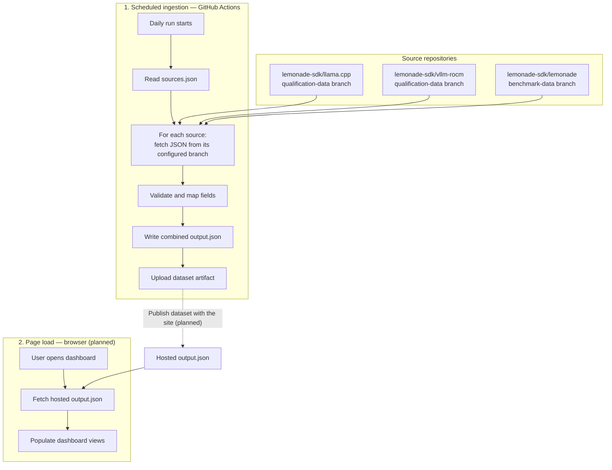

# Data flow

Data moves at two different times: Actions refreshes the dataset on a schedule,
and the browser reads that dataset when someone opens the dashboard.

Each ingestion run reads the latest revision of each configured branch and records
which revision supplied the data. Original JSON copies accompany the combined
dataset so results can be traced back to their sources. Manual and pull request
runs use the same ingestion steps.

Ingestion currently produces a downloadable Actions artifact. Site publishing and
browser loading are the next implementation stage. Once connected, page loads
use the published dataset; scheduled ingestion refreshes it independently.

See [adding or changing a source](data-pipeline.md#adding-or-changing-a-source)
for a configuration example and the pull request workflow.
