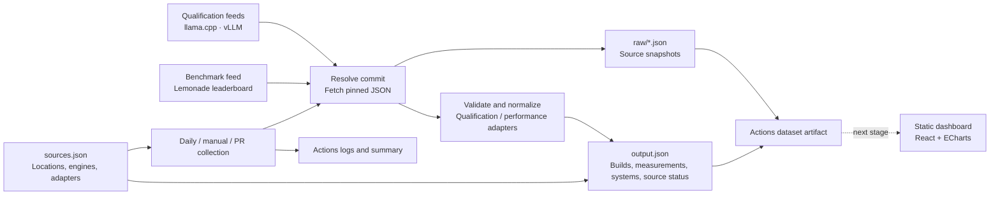
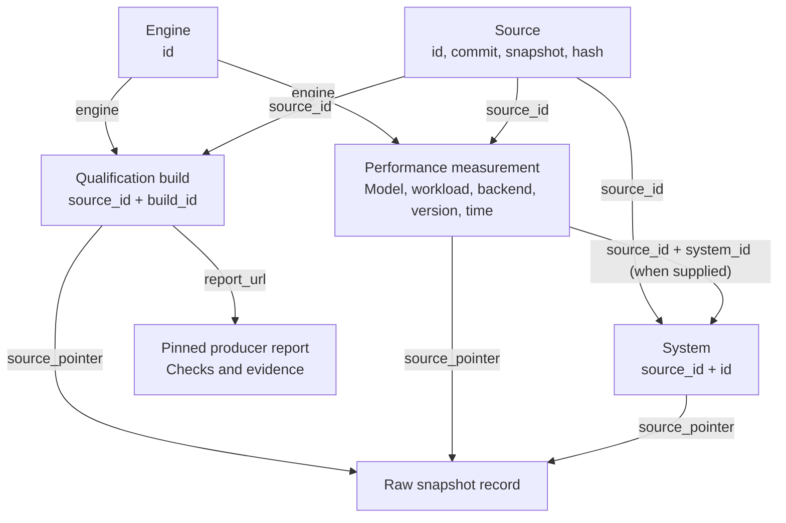

# Data flow

## Collection

Pending feeds contribute an awaiting-data status without a fetch. Failed feeds
contribute an error status and no normalized records; the artifact is diagnostic.
The dashboard and publishing are the next stage.

## Record relationships

Builds and measurements share an engine, but have no confirmed artifact-level
join. Performance build attribution and ROCm version remain null. Historical
measurements can also lack system metadata.
