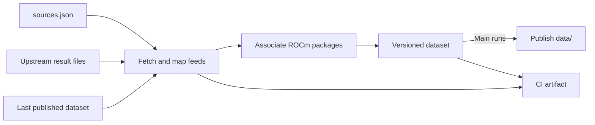
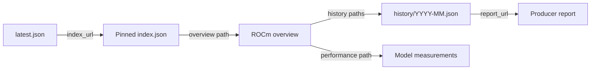

# Data flow

## Ingestion

| Input | What it is and where it comes from |
| --- | --- |
| [sources.json](../sources.json) | Configuration maintained here: source repositories, branches, files, adapters, and filters. [Configuration guide](data-pipeline.md#adding-or-changing-a-source). |
| [Upstream result files](data-pipeline.md#current-sources) | llama.cpp's [qualification index](https://github.com/lemonade-sdk/llama.cpp/blob/qualification-data/qualification/index.json) and Lemonade's [benchmark leaderboard](https://github.com/lemonade-sdk/lemonade/blob/benchmark-data/leaderboard.json). [Retained fields](data-pipeline.md#what-we-retain). |
| [Last published dataset](data-publication.md#dataset-entry-point) | Our saved JSON from the last successful publication, restored using the [latest.json pointer](data-publication.md#dataset-entry-point). It preserves build/model history and verified package associations across runs. |

The [JSON reference](reference/README.md) documents file contracts, field lineage,
and pinned mapping examples.

The output is the [published data directory](data-publication.md#published-files),
including its [latest.json pointer](data-publication.md#dataset-entry-point).

PRs validate a fresh collection from producer feeds and upload an artifact.
Main runs publish successful datasets. Failed runs update live `latest.json` and
`sync.json` with the error while retaining the last good dataset pointer.
CI artifacts contain source copies and diagnostics and are [retained for 30 days](data-publication.md#history-grouping-and-retention).
Published build history is preserved across runs and grouped by calendar month.

llama.cpp reads stable builds from `lemonade-sdk/llama.cpp` and their stable
ROCm model results from Lemonade's benchmark feed.
See [data pipeline](data-pipeline.md) for sources, adapters, channels, and how to
add a feed.

## Published data

`index.default_version` identifies the default ROCm version. Overviews contain
latest build and performance summaries and links to their history.
See [file definitions](data-publication.md#published-files) and
[history grouping](data-publication.md#history-grouping-and-retention).
