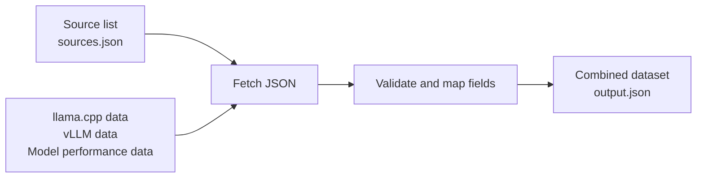
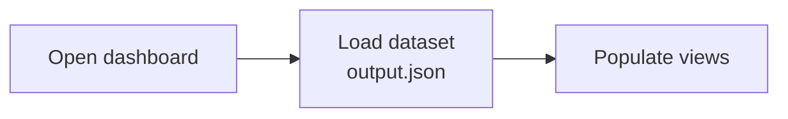

# Data flow

## Data sources

| Name in the diagrams | Repository |
| --- | --- |
| llama.cpp data | [lemonade-sdk/llama.cpp](https://github.com/lemonade-sdk/llama.cpp) |
| vLLM data | [lemonade-sdk/vllm-rocm](https://github.com/lemonade-sdk/vllm-rocm) |
| Model performance data | [lemonade-sdk/lemonade](https://github.com/lemonade-sdk/lemonade) |

## 1. Scheduled ingestion

The daily job reads the source list, fetches the latest data, and combines it.

Each entry in the source list specifies a repository, branch, file, and mapping.
The job uploads the dataset and original JSON files as a downloadable artifact.
Manual and pull request runs follow the same steps.

## 2. Page load

When someone opens the dashboard, the browser reads the published dataset.

Site publishing and page loading are planned. Publishing will place the dataset
alongside the web app; each daily ingestion run will provide a new dataset.

See [adding or changing a source](data-pipeline.md#adding-or-changing-a-source)
for an example and the pull request workflow.
