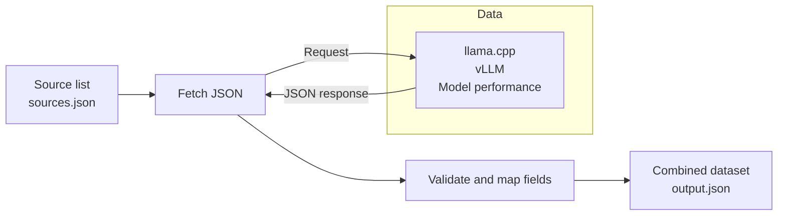
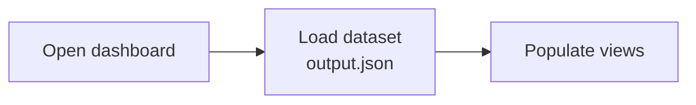

# Data flow

## Data sources

| Data | Repository branch | JSON file |
| --- | --- | --- |
| llama.cpp | [llama.cpp / qualification-data](https://github.com/lemonade-sdk/llama.cpp/tree/qualification-data) | [qualification/index.json](https://github.com/lemonade-sdk/llama.cpp/blob/qualification-data/qualification/index.json) |
| vLLM | [vllm-rocm / qualification-data](https://github.com/lemonade-sdk/vllm-rocm/tree/qualification-data) | [qualification/index.json](https://github.com/lemonade-sdk/vllm-rocm/blob/qualification-data/qualification/index.json) |
| Model performance | [lemonade / benchmark-data](https://github.com/lemonade-sdk/lemonade/tree/benchmark-data) | [leaderboard.json](https://github.com/lemonade-sdk/lemonade/blob/benchmark-data/leaderboard.json) |

## 1. Scheduled ingestion

The daily job reads the source list, fetches the latest data, and combines it.

Fetch JSON requests each source file and receives its JSON response.
Each entry in the source list specifies a repository, branch, file, and mapping.
The job uploads the dataset and original JSON files as a downloadable artifact.
Manual and pull request runs follow the same steps.

## 2. Page load

When someone opens the dashboard, the browser reads the published dataset.

Site publishing and page loading are planned. Publishing will place the dataset
alongside the web app; each daily ingestion run will provide a new dataset.

See [adding or changing a source](data-pipeline.md#adding-or-changing-a-source)
for an example and the pull request workflow.
