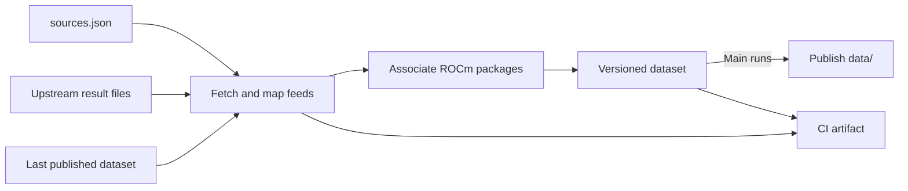
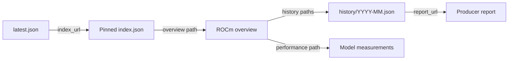

# Data flow

## Ingestion

| Input | What it is and where it comes from |
| --- | --- |
| `sources.json` | Configuration maintained in this repository: source repositories, branches, files, adapters, and filters. |
| Upstream result files | Qualification indexes published by llama.cpp and vLLM, and the benchmark leaderboard published by Lemonade. [Source files](data-pipeline.md#what-we-retain). |
| Last published dataset | Our saved JSON from the last successful publication, restored using `data/latest.json`. It preserves build/model history and verified package associations across runs. |

The output is the `data/` directory, including its `latest.json` pointer.

PRs validate and upload an artifact. Main runs publish successful datasets;
failed runs report the error in `latest.json.sync` and retain the last good pointer.
CI artifacts contain source copies and diagnostics and are retained for 30 days.
Published build history is preserved across runs and grouped by calendar month.

llama.cpp reads stable builds from `lemonade-sdk/llama.cpp` and their stable
ROCm model results from Lemonade's benchmark feed.
See [data pipeline](data-pipeline.md) for sources, adapters, channels, and how to
add a feed.

## Published data

`index.default_version` identifies the default ROCm version. Overviews contain
latest build and performance summaries and links to their history.
See [file definitions and history grouping](data-publication.md#published-files).
