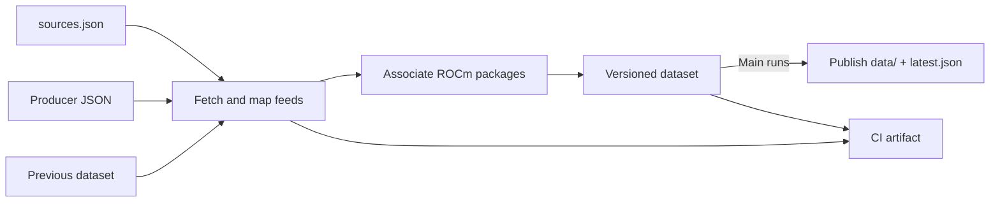
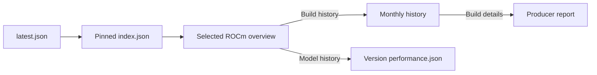

# Data flow

## Ingestion

The workflow runs daily at 11:17 UTC, on PRs and main pushes, or by manual dispatch.

PRs validate and upload an artifact. Main runs publish successful datasets;
failed runs report the error in `latest.json.sync` and retain the last good pointer.
CI artifacts contain source copies and diagnostics and are retained for 30 days.

llama.cpp reads stable builds from `lemonade-sdk/llama.cpp` and selects only their
stable ROCm model results from Lemonade's benchmark feed. Nightly qualification
will come from `lemonade-sdk/llamacpp-rocm` on `qualification-data`, once the
producer publishes the feed ([#4](https://github.com/lemonade-sdk/rocm-readiness/issues/4)).
See [data pipeline](data-pipeline.md) for sources, adapters, channels, and how to
add a feed.

## Dashboard loading

The dashboard UI is the next implementation stage. Its loading contract is:

The initial selection uses `index.default_version`. Overviews contain latest build
and performance summaries. Other files load when the user opens their view.
See [data publication](data-publication.md) for file contents and version directories.
