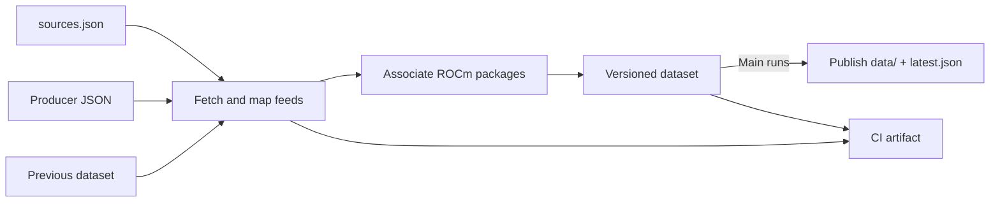

# Data flow

## Ingestion

The workflow runs daily at 11:17 UTC, on PRs and main pushes, or by manual dispatch.

PRs validate and upload an artifact. Main runs publish successful datasets;
failed runs report the error in `latest.json.sync` and retain the last good pointer.
CI artifacts contain source copies and diagnostics and are retained for 30 days.

llama.cpp reads stable builds from `lemonade-sdk/llama.cpp` and their stable
ROCm model results from Lemonade's benchmark feed.
See [data pipeline](data-pipeline.md) for sources, adapters, channels, and how to
add a feed.

## Published data

`index.default_version` identifies the default ROCm version. Overviews contain
latest build and performance summaries and links to their history.
See [data publication](data-publication.md) for file contents and version directories.
