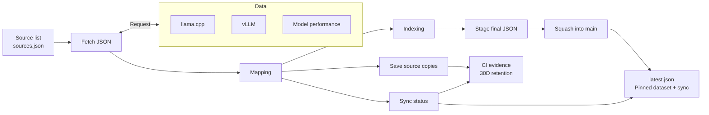
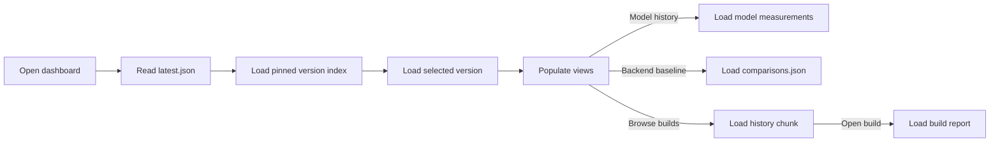

# Data flow

## Data sources

| Data | Repository branch | JSON file |
| --- | --- | --- |
| llama.cpp | [llama.cpp / qualification-data](https://github.com/lemonade-sdk/llama.cpp/tree/qualification-data) | [qualification/index.json](https://github.com/lemonade-sdk/llama.cpp/blob/qualification-data/qualification/index.json) |
| vLLM | [vllm-rocm / qualification-data](https://github.com/lemonade-sdk/vllm-rocm/tree/qualification-data) | [qualification/index.json](https://github.com/lemonade-sdk/vllm-rocm/blob/qualification-data/qualification/index.json) |
| Model performance | [lemonade / benchmark-data](https://github.com/lemonade-sdk/lemonade/tree/benchmark-data) | [leaderboard.json](https://github.com/lemonade-sdk/lemonade/blob/benchmark-data/leaderboard.json) |

## 1. Scheduled ingestion

The daily job reads the source list, fetches the latest data, and combines it.

Fetch JSON requests each source file and receives its JSON response.
Each entry in the source list specifies a repository, branch, file, and mapping.
The job groups builds by ROCm version, writes compact summaries and monthly
history chunks. Trusted runs stage final JSON on a temporary working branch,
squash those changes into `main`, and update the latest pointer in the same push.
Each run restores build and model history from `main/data/`.
ROCm package associations use saved evidence, authenticated benchmark job logs,
and release metadata for stable, nightly, and experimental results.
PR runs validate and upload temporary artifacts. Raw copies and logs remain in
those artifacts. Failed main runs update only the latest sync status.

## 2. Page load

When someone opens the dashboard, the browser reads the version index and the
overview for the selected ROCm version. `latest.json` supplies the current sync
status and pins the index and data files to one immutable commit.

The initial selection uses `index.default_version`, the newest indexed ROCm
version. Selecting or comparing another version loads its overview. Overviews
include the latest build and performance summaries; full model measurements,
build history, and reports load when requested. A Vulkan baseline loads comparison
records and filters to the Vulkan backend, matching model, workload, quantization,
and hardware. HRX records remain a separate comparison backend.

The browser does not fetch every generated JSON file. Current errors and sync
status come from `latest.json.sync`. Raw source copies, standalone errors,
intermediate provenance, and publication state remain in 30-day CI artifacts;
they are not part of the published runtime dataset. The browser processes only
the requested published JSON locally. See the [runtime file inventory](data-publication.md#published-files-and-ci-artifacts).

The workflow publishes the versioned JSON. Browser views are the next stage.

See [adding or changing a source](data-pipeline.md#adding-or-changing-a-source)
for an example and the pull request workflow.
