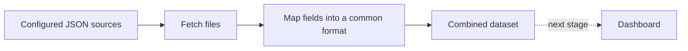

# Data flow

The source repositories already contain the results. This app reads those files
and combines them; it does not run tests or benchmarks.

The current pipeline uploads the dataset as a downloadable Actions artifact.
Connecting it to the dashboard comes next. Original JSON copies are saved alongside
the dataset so each result can be checked against its source.

See [adding or changing a source](data-pipeline.md#adding-or-changing-a-source)
for a configuration example and the pull request workflow.
