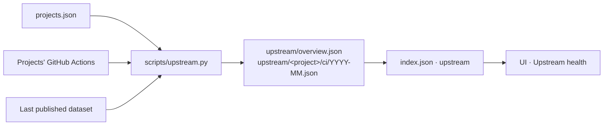

# Upstream health

The dashboard has two views over one published dataset:

- **ROCm readiness** answers how ready a ROCm version is. It reads fork and
  qualification feeds by ROCm version and channel.
- **Upstream health** answers how healthy Radeon and Ryzen AI support is in each
  project as it ships. It reads each project's own GitHub Actions on its
  default branch.

Both views are collected by the same run of `scripts/check.py` and published
behind the same `latest.json` pointer.



## What is collected

`projects.json` lists the projects. For each one it names:

- the repository and its default branch;
- the jobs that build for, or run on, client AMD hardware, each with a
  category (`tests`, `builds`, `nightlies` or `releases`), software stack, GPU
  target and operating system;
- the forks that carry AMD work;
- what the project ships per operating system.

For every configured job on the default branch, the collector records:

- the job's own result;
- its first failing step;
- its queue wait;
- its links.

For pushes that came from a pull request, the collector also records what the
same job said on the pull request's final commit.

The rules below are deliberate. Each one fixed a wrong number during the
investigation that produced this view.

| Rule | Why |
| --- | --- |
| Default branch only. Pull request runs and PyTorch's `ciflow/<workflow>/<PR>` tag pushes are skipped. Release tags count only when a project sets `tag_pattern`. | A contributor iterating on a broken branch is the gate working, not a regression. |
| A job is judged by its own conclusion, never the workflow's. | Workflows mix NVIDIA, Apple and AMD jobs. |
| A job with no steps never reached a machine. `skipped` means its own condition switched it off. Anything else is "requested, never ran". | A cancelled job is not a failed one. A dead runner otherwise shows nothing red. |
| Merge verdicts come from the check runs on the pull request's final head commit. | The workflow-run list is capped at ten pages and eventually consistent. |
| Re-run bookkeeping that puts `created_at` after `started_at` is dropped, not clamped. | Clamping invents a zero wait. |

## Upstream badge

The badge is computed from the collected jobs. Nothing sets it by hand.

| Badge | Rule |
| --- | --- |
| upstream | A test on the default branch ran on a GPU in `client_rule.targets` (gfx1151 or gfx1201). |
| partially upstream | Other client hardware was tested on the default branch, for example the Ryzen AI NPU or a Radeon RX 7900 (gfx1100). |
| not upstreamed | No test on the default branch ran on client hardware. A project's `note` explains why. |

## Collection budget

Upstream collection runs after the readiness dataset is written, and it never
degrades it. A project that cannot be read keeps its previous records and is
marked `partial`.

A run spends at most `UPSTREAM_API_BUDGET` GitHub API calls. The default is
800, which is inside the hourly `GITHUB_TOKEN` limit. The budget is split
evenly across projects, and the newest runs are read first. Runs already
recorded as complete in the previous dataset cost no calls.

Once a project's window has been read completely, later collections list only
recent runs. A first collection over a 30 day window may need several daily
runs to fill. Until it is full, the project's `coverage.complete` is false and
the UI says so.

## Published files

| Path | Contents |
| --- | --- |
| `index.json` → `upstream` | `overview` path, `project_count`, `status` (`fresh` or `partial`), `api_calls` |
| `upstream/overview.json` | Window, client rule, and per project: badge, forks, KPIs, per-job daily aggregates, merge gate, platforms, findings, coverage, monthly files |
| `upstream/<project>/ci/YYYY-MM.json` | Every retained job execution in the window, plus the scanned run ids that let the next collection skip them |

`scripts/conformance.py` validates every file and its totals against the
overview. `scripts/publish.py` includes them in the publication manifest.

## Running it locally

The full pipeline, as CI runs it:

```sh
GH_TOKEN=<token> uv run --no-project --python 3.12 python scripts/check.py \
  --output-dir data/local-preview --previous-data data
```

To refresh only the upstream view in an existing dataset, which is faster
while you work on it:

```sh
GH_TOKEN=<token> uv run --no-project --python 3.12 python scripts/upstream.py \
  --output-dir data/local-preview --seed-from data --budget 800
```

Run the second command again to fill a large window: each run reuses what the
previous one recorded. Then open the dashboard against that directory:

```sh
cd ui
npm run dev:local
```

`dev:local` serves `../data/local-preview` at `/local-data/`. Set
`LOCAL_DATA_DIR` to read a different directory. The footer reads
"Local dataset preview".

## Adding a project

Add an entry to `projects.json`, then run the unit tests and a local
collection. `tests/test_upstream.py` validates the shipped file.

```json
{
  "id": "example",
  "label": "Example",
  "repository": "owner/example",
  "default_branch": "main",
  "forks": [{"repository": "org/example", "role": "ROCm builds", "channel": "nightly"}],
  "ships": {"linux": "ROCm wheels"},
  "jobs": [
    {"id": "gpu-tests", "label": "gpu tests", "category": "tests",
     "workflow": "ci.yml", "match": {"name": "rocm-gfx1151"},
     "target": "gfx1151", "stack": "rocm", "os": "linux",
     "where": "Strix Halo runner", "cadence": "per push"}
  ]
}
```

`match` takes exactly one of `name` (exact), `prefix` or `regex`. It is matched
against the job name GitHub reports. GitHub cuts job names at 100 characters,
so prefer a prefix for matrix jobs.
